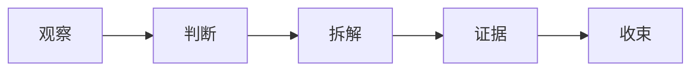

# 在安静的页面里，让判断慢慢显形

_一篇用于 Claude 主题的中文专栏样张。它不追求热闹，而是观察文字、留白和编辑层次如何共同工作。_

> 好的排版不是让每个元素都变得醒目。它更像一次认真编辑：把真正重要的句子留下，把次要信息放到正确的位置。

很多公众号主题会把设计感理解成装饰：标题加色块，引用加阴影，表格加圆角，段落之间再塞几条线。这样当然能变丰富，但文章很容易失去一种更难得的东西：**读者愿意把注意力交给文字本身。**

Claude 主题尝试做另一件事。它把页面底色降到暖纸面，把正文压回深墨色，把强调色留给少数线条和关键词。它不是一个“热闹”的主题，而是一个适合长文、访谈、评论和技术随笔的编辑版式。

---

## 一、标题先建立语气

标题不一定要像组件。一个好的标题系统，首先要让读者知道这篇文章的语气：是急促的、轻松的、技术化的，还是经过编辑整理的。

在 Claude 主题里，H1 更像文章封面标题，H2 像章节入口，H3 则是段落内部的路标。主题色只作为短线出现，不抢正文的主导权。

### 这不是极简，而是克制

极简很容易走向无表情。克制则不同：它允许页面有温度，但不让温度变成噪音。比如 **粗体** 不再只是变成主题色，而是像印刷物里的重点句；==高亮== 也更像编辑在稿纸上留下的一笔，而不是一个 UI 标签。

> [!NOTE] 编辑说明
> 如果一篇文章本身有明确观点，排版只需要把观点显露出来。它不应该替作者制造情绪。

## 二、正文要有慢下来的余地

中文长文最怕行距紧、段距乱、强调太多。读者在手机屏幕上滑动时，如果每一屏都像信息流卡片，就很难进入连续阅读状态。

Claude 主题把正文行距放得更松，段落之间保留稳定间距。链接例如 [Anthropic](https://www.anthropic.com/) 会被识别出来，但不会像按钮一样跳出来。行内术语 `constitutional AI`、`tool use`、`long context` 也会被压成资料标记，而不是代码编辑器里的碎片。

### 可以被带走的一句话

**真正好的公众号版式，不是让读者看到你用了多少样式，而是让他忘记样式正在工作。**

---

## 三、资料元素要像编辑注解

引用、表格和代码块不应该都变成卡片。它们的共同任务，是让资料被整理，而不是让版面变得拥挤。

| 元素  | Claude 主题里的角色 | 使用建议               |
| ----- | ------------------- | ---------------------- |
| 引用  | 第二声部            | 放判断、旁白、访谈摘句 |
| Alert | 编辑注解            | 放限制条件、阅读提示   |
| 表格  | 资料整理            | 少列数，少边框重量     |
| 代码  | 术语或示例          | 服务论述，不喧宾夺主   |

::: remark 版式判断
当一个块元素出现时，读者应该立刻知道它为什么被拿出来单独看。如果只是为了让页面不单调，它就应该回到正文里。
:::

```ts
const editorialTheme = {
  surface: 'warm paper',
  text: 'deep ink',
  accent: 'clay line',
  goal: 'make the argument readable',
}
```

## 四、结构图只做必要的指路

文章如果有清楚的论证路径，可以偶尔用流程图帮助读者建立地图。图本身不用复杂，越像编辑手稿里的路线，越适合这种主题。



流程图之后要回到文字。图只是入口，真正的说服仍然发生在段落里。


_图注应该补充观看角度，而不是重复图片标题。这里的图片只是占位，发布时应替换成真实题图、截图或资料图。_

---

## 五、结尾收回到一个标准

判断一个主题是否适合长期使用，不要只看第一屏。应该把一篇两三千字的文章放进去，看它在第三屏、第五屏、第八屏是否还稳定。

如果读者一路读下来，只记得观点、节奏和几处恰当的停顿，而不是记得“这个标题样式很用力”，那它就接近了我们想要的状态。

**Claude 主题的目标，是让公众号文章看起来像一篇被认真编辑过的文本，而不是一个 Markdown 预览页面。**[^1]

[^1]: 这里的 Claude 指向一种暖色、克制、文字优先的编辑气质；实现上仍是本项目的微信兼容主题，并不复制官方网页结构或品牌资产。
